<p align="center">
  
</p>

<h1 align="center">DeckDam</h1>

<p align="center">
  <b>Which Pokémon TCG deck does your card fit?</b><br />
  Search any Standard-legal card and see which competitive archetypes play it, how many copies and with which partners.
</p>

<p align="center">
  <a href="https://deckdam.vercel.app"><b>🌐 Live site: deckdam.vercel.app</b></a> ·
  <a href="https://github.com/Dami1603/DeckDam/releases/latest">Latest release</a>
</p>

<p align="center">
  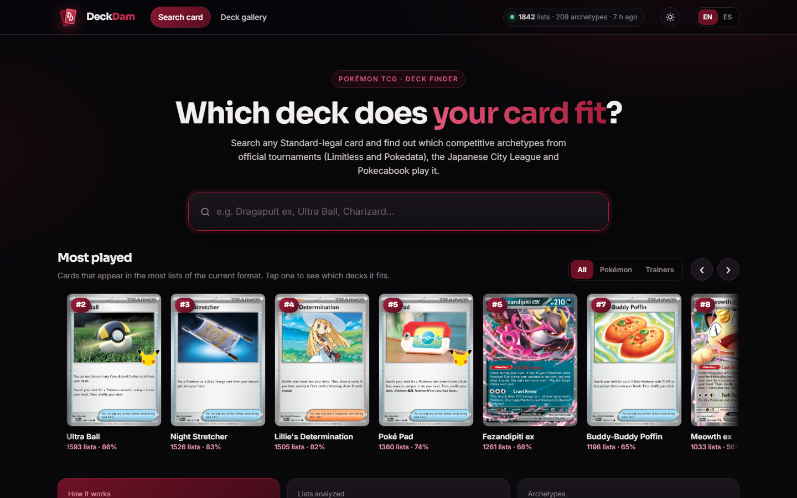
</p>

## Features

- **Card search** across every Standard and Expanded-legal card (Black & White onward), in English or Spanish, powered
  by [TCGdex](https://tcgdex.dev). Expanded-only cards are tagged.
- **Which decks it fits**: archetypes that play the card, inclusion rate in each one, average copies and every list that
  uses it.
- **Exact card identity**: two cards with the same name but different attacks (e.g. several "Moltres") are counted
  separately; reprints with the same text count together.
- **Often played with**: the cards that usually go with it, leaving out generic staples like Boss's Orders or Ultra Ball.
- **Full card text** with the original energy symbols: abilities, attacks (cost, damage, effect), weakness, resistance
  and retreat, plus the **TCGplayer price** in USD.
- **Japan-only cards**: cards already played in Japan but not released in English yet, with their text translated.
- **Expansions**: every Standard-legal set with its logo and release date; open one to see all its cards and how many
  competitive lists play each (sortable by card number or most played).
- **Expanded**: a Standard / Expanded switch in the deck gallery shows winning Expanded lists from the official Japanese Expanded events; every card page also has a
  Standard / Expanded switch.
- **Deck gallery** with filters by source, date range and archetype family, sorting by rarity and Limitless-style
  Pokémon sprites.
- **Automatic updates** every 12 hours from five sources, **English / Spanish** interface, **light / dark** mode, mobile
  friendly and basic SEO.

## Screenshots

| Card view | Deck gallery |
|---|---|
| 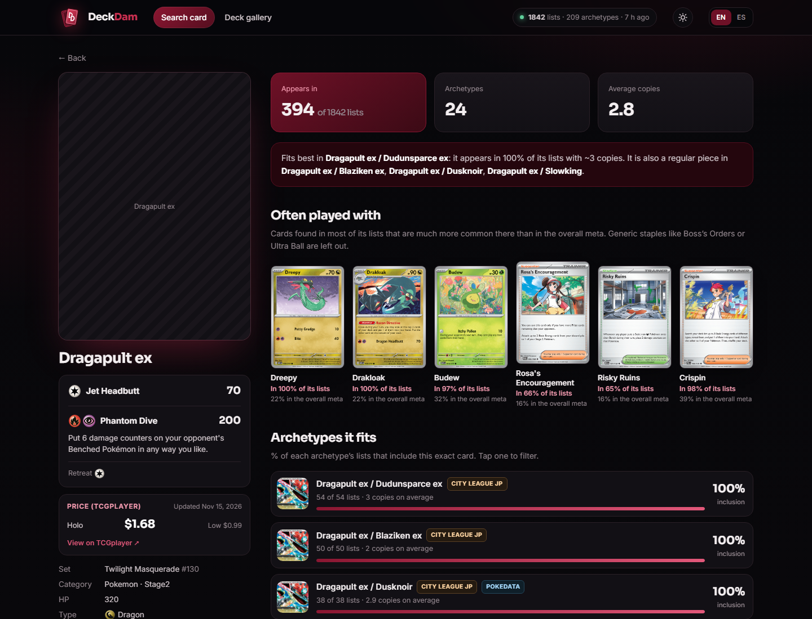 | 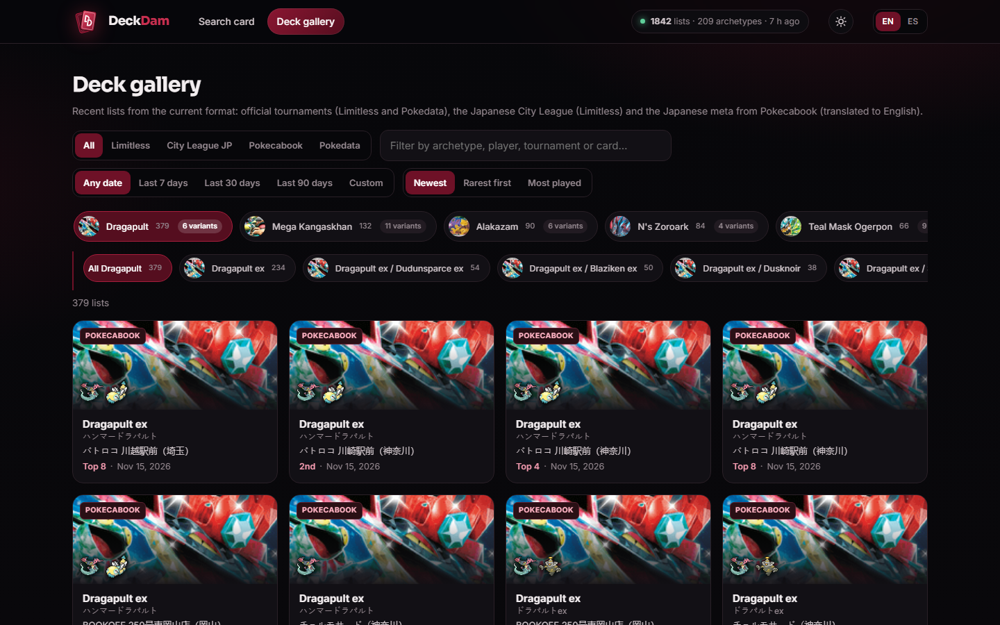 |
| **Deck list** | **Light mode** |
| 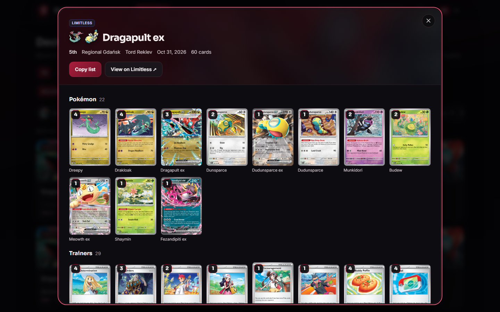 | 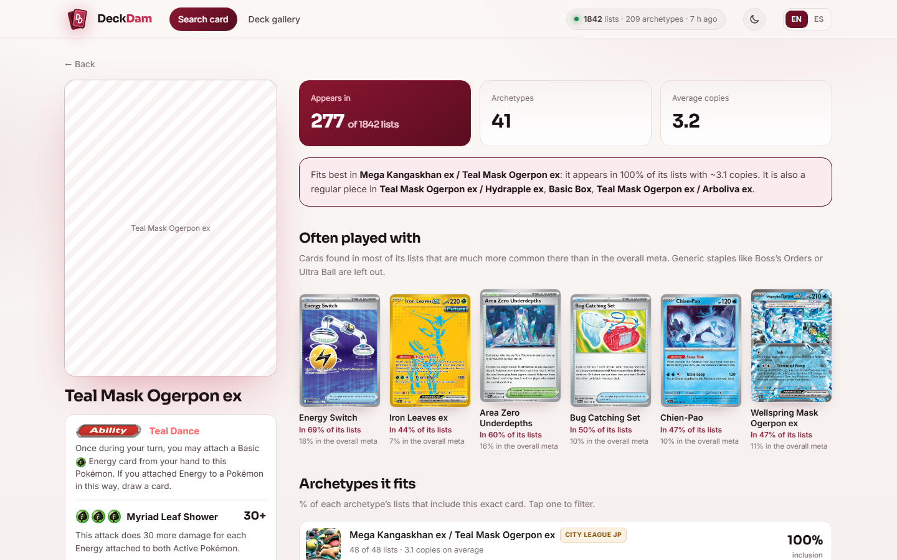 |
| **Expansions** | **Expansion cards by usage** |
| 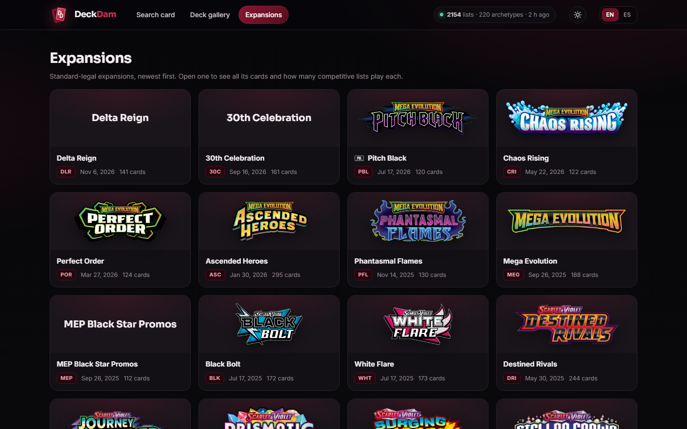 | 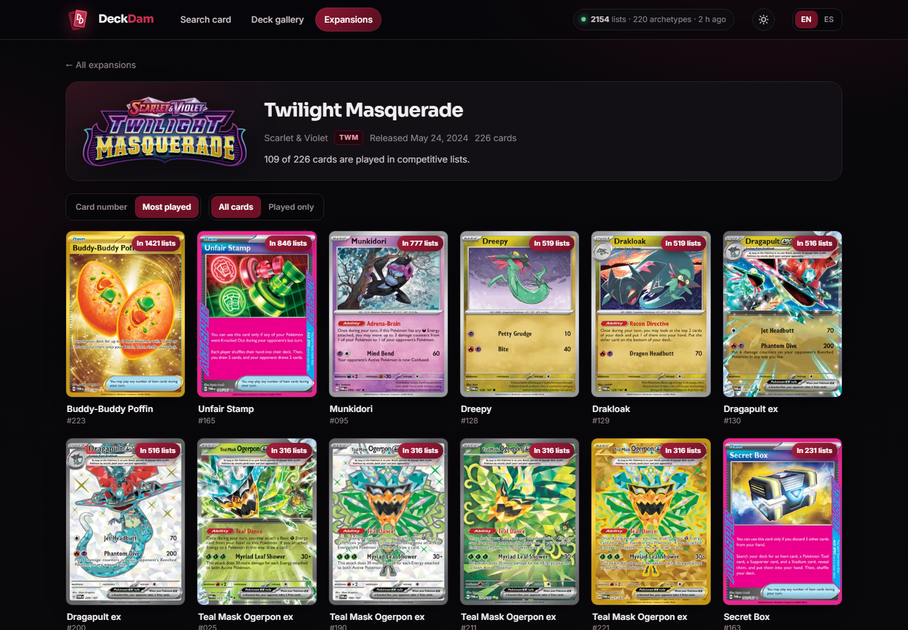 |
| **Expanded gallery** | **Card view in Expanded** |
| 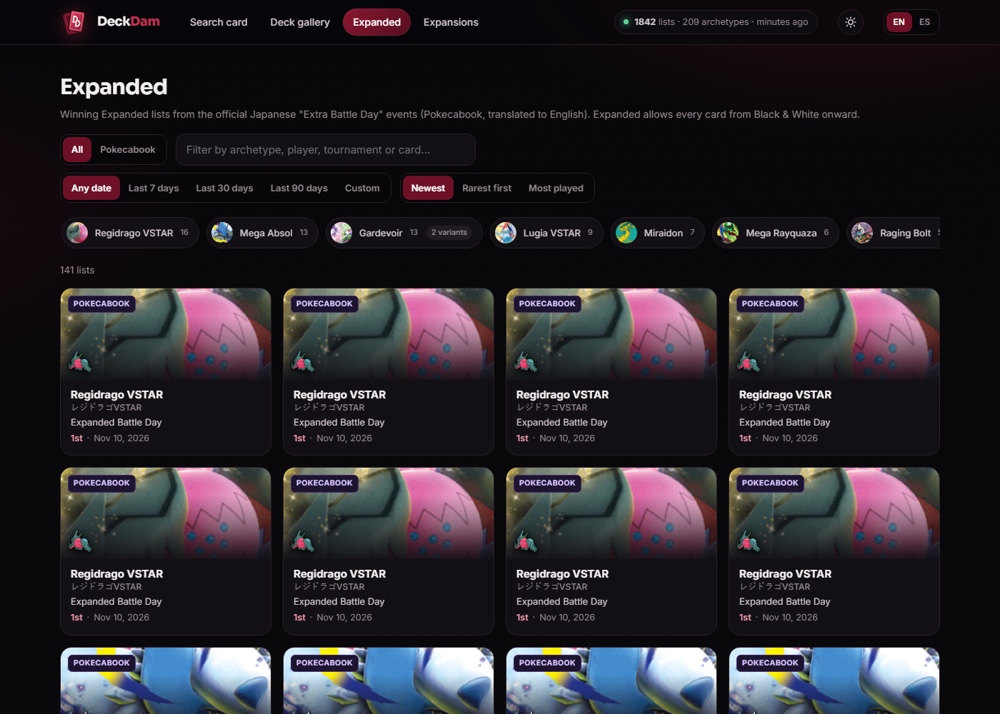 | 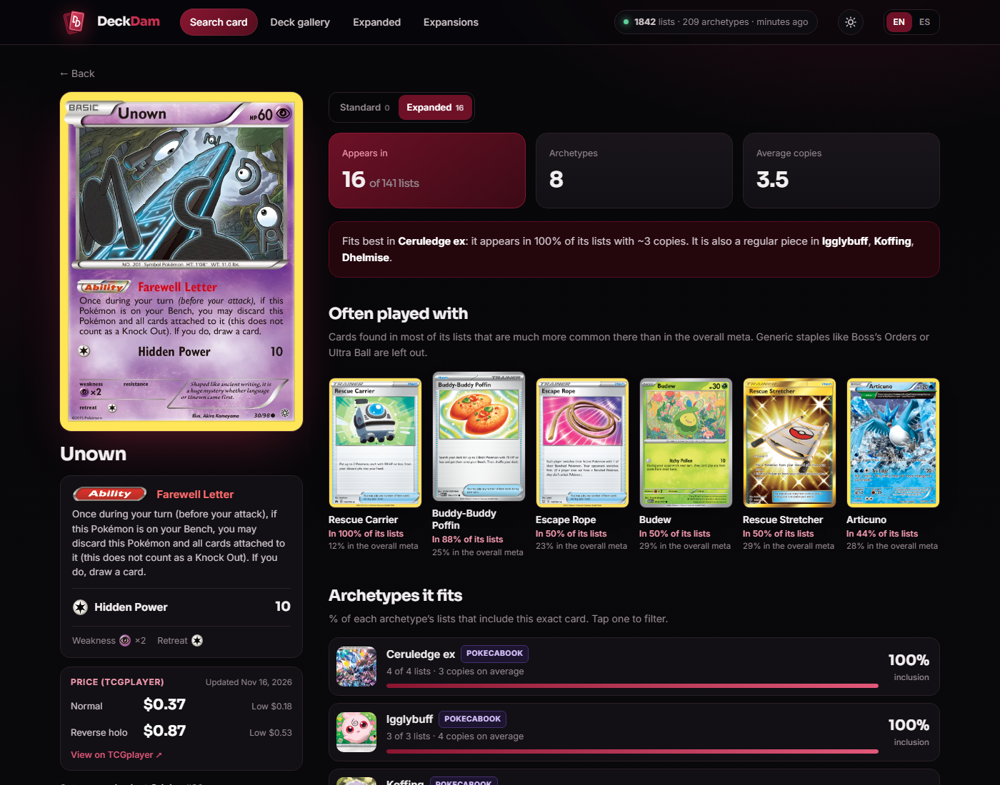 |
| **Spanish interface** | **Mobile** |
| 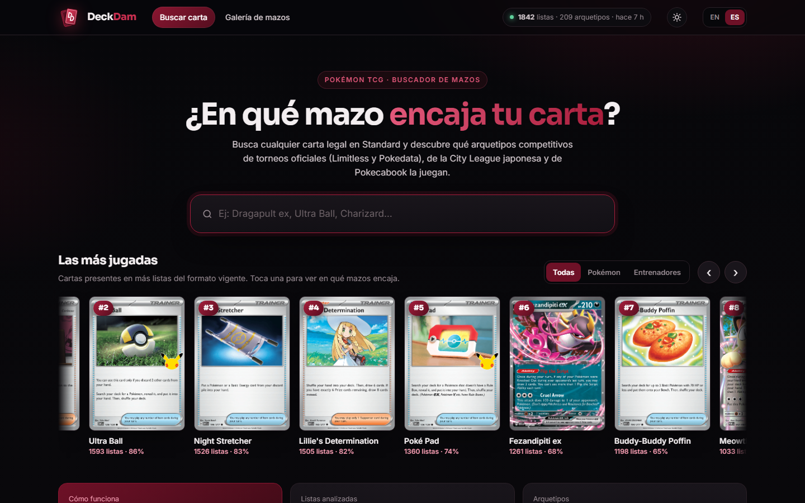 | 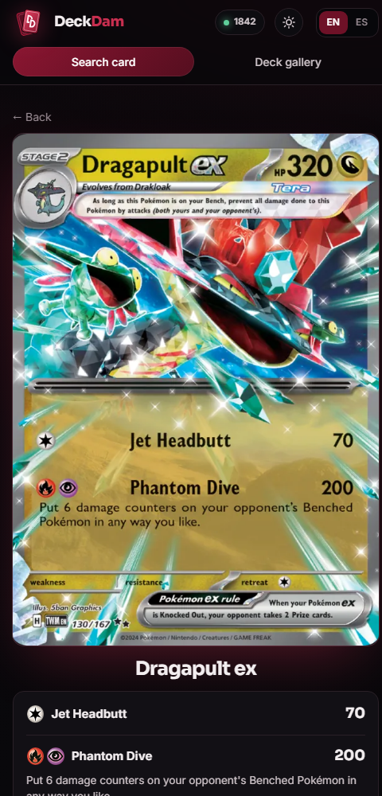 |

## Data sources

| Source | What is taken |
|---|---|
| [Limitless TCG](https://limitlesstcg.com/decks) | Up to 30 archetypes of the **current format** and the 6 most recent lists of each (Regionals, Internationals, Worlds). |
| [Limitless City League JP](https://limitlesstcg.com/tournaments/jp) | Japanese tournaments of the last 14 days and their top 8 lists, already translated to English. The archetype comes from the list icons. |
| [Pokedata](https://www.pokedata.ovh/standings) | Official Play! Pokémon tournaments (Masters) since the start of the current format, top 64 with records. Archetypes are **classified** by comparing each list with the known ones ([scraper/classify.js](scraper/classify.js)). |
| [Pokecabook](https://pokecabook.com/archives/1417) | Japanese meta: the archetype indexes ([1417](https://pokecabook.com/archives/1417), [6132](https://pokecabook.com/archives/6132)) and the daily Gym Battle winners ([27265](https://pokecabook.com/archives/27265)). Official deck codes are read from pokemon-card.com and every card is translated to English through Limitless' Japanese card database. |
| [Pokecabook Expanded](https://pokecabook.com/archives/category/tournament/extra) | **Expanded** format: the latest Japanese Expanded event reports (Battle Days, Champions League) and the decks in each, read and translated the same way. |

Cards and card text come from [TCGdex](https://tcgdex.dev) (free, no API key). Japan-only cards use the translated
Limitless card sheet ([jpcard.js](jpcard.js)).

## How it works

### Card identity

Every card has an **identity** ([public/cardkey.js](public/cardkey.js)) shared by the scraper, the server and the
browser:

- **Pokémon:** name + attacks (or abilities when it has no attacks). Attacks come from Limitless for deck cards and from
  TCGdex for the searched card. Reprints with the same text count together; different versions appear under
  "Other versions".
- **Trainers and Energy:** name only, normalized (no accents, unified apostrophes, "Basic Psychic Energy" = "Psychic
  Energy").
- Japanese prints that have an international version use the official English attacks, so they count as the same card.

Search shows only **Standard-legal** cards (TCGdex `legal.standard`, plus new sets TCGdex does not flag yet, listed in
`STANDARD_EXTRA_SETS` in `public/app.js`), without Pokémon TCG Pocket.

### Partners ("Often played with")

Up to 6 cards present in at least 40% of the card's lists and at least 1.5× more common there than in the overall meta.
Generic staples (in 45% or more of all lists), basic Energy and other versions of the same card are excluded. Tunable
with `PARTNER_STAPLE`, `PARTNER_MIN_RATE` and `PARTNER_MIN_LIFT`.

### Archetype families and sprites

- The gallery groups archetypes into **families** by their main Pokémon ([family.js](family.js)): "Dragapult" gathers
  Dragapult ex, Dragapult ex / Dudunsparce ex, Dragapult ex / Blaziken ex, etc. Picking a family shows its variants.
- Every deck shows the **sprite** of its main Pokémon, Limitless style. Sources without sprites get them computed from
  the archetype name (`kangaskhan-mega`, `exeggutor-alola`, `ogerpon-wellspring`…) in
  [scraper/sprites.js](scraper/sprites.js), plus a second sprite for the **companion** the list actually runs
  (e.g. Dragapult ex + Dusknoir), ignoring generic support Pokémon.

### SEO

Home page meta tags (title, description, canonical, Open Graph, Twitter card, JSON-LD `WebApplication`), a 1200×630
share image, `/robots.txt`, `/sitemap.xml` and a dynamic title/description per view. Set `SITE_URL` to the public domain
when deploying. Internal views use `#` routes, which search engines do not index.

## Architecture and deployment

DeckDam runs **for free** on Vercel + GitHub Actions:

```
GitHub Actions (every 12 h)                     Vercel
┌──────────────────────────────┐                ┌──────────────────────────────────┐
│ npm ci → scraper → decks.json│ ── upload ──▶  │ Vercel Blob  (decks.json)        │
│ actions/cache keeps the      │                │        ▲ revalidated every 5 min │
│ scraper cache between runs   │                │ api/index.js → server.js (API)   │
└──────────────────────────────┘                │ dist/ static frontend (CDN)      │
                                                └──────────────────────────────────┘
```

- **Vercel** serves the frontend as static files (`dist/`, built by `scripts/build-static.mjs`) and the API as a
  function (`api/index.js`, the same Express app as `server.js`). The function reads the decks from **Vercel Blob** and
  re-checks them every 5 minutes with `If-None-Match`.
- **GitHub Actions** ([.github/workflows/scrape.yml](.github/workflows/scrape.yml)) runs the scraper every 12 hours and
  uploads `data/decks.json` to Blob with `scripts/blob.mjs`.
- The frontend is not in this repository, so it is **deployed from a local machine** with the Vercel CLI
  (`.vercelignore` defines what is uploaded). The GitHub repository is intentionally not connected to the Vercel project.

One-time setup:

1. `npx vercel` to log in and create the project, then `npx vercel --prod` to deploy.
2. Create a Blob store and connect it to the project (`npx vercel blob create-store <name> --access public --yes`), which
   adds `BLOB_READ_WRITE_TOKEN`.
3. Upload the current decks: `node --env-file=.env.local scripts/blob.mjs upload`.
4. In GitHub, add the repository secret `BLOB_READ_WRITE_TOKEN` (**Settings → Secrets and variables → Actions**).
5. Optional: set `SITE_URL` in Vercel to the public domain.

To publish frontend changes: `npx vercel --prod`. Decks update on their own.

## Running locally

Requires **Node.js 18+**.

```bash
npm install
npm run scrape      # downloads the decks and builds data/decks.json (first run takes ~10–20 min)
npm start           # http://localhost:3000
```

Locally the server also updates the decks every 12 hours on its own (`SCRAPE_INTERVAL_HOURS`, `0` disables it) and never
runs two scrapes at once. `npm run scrape` can be run at any time; the server picks up the new data without a restart.

> The interface (`public/index.html`, `public/styles.css`) is not included in this repository, so you need to provide
> your own `index.html` to use the web UI. The API works without it.

### Scraper options

| Command / variable | What it does | Default |
|---|---|---|
| `npm run scrape:limitless` / `scrape:limitless-jp` / `scrape:pokecabook` / `scrape:pokedata` / `scrape:expanded` | Updates a single source and keeps the other active ones | — |
| `SOURCES` | Active sources, comma separated (the rest are removed from the data) | `limitless,limitless-jp,pokecabook,pokedata,pokecabook-expanded` |
| `LIMITLESS_ARCHETYPES` | Limitless archetypes to read | 30 |
| `LIMITLESS_LISTS` | Lists per archetype | 6 |
| `LIMITLESS_JP_DAYS` | Days of Japanese tournaments to read | 14 |
| `LIMITLESS_JP_TOP` | Placements per Japanese tournament (top N) | 8 |
| `POKEDATA_TOP` | Placements per official tournament (top N, Masters) | 64 |
| `POKEDATA_SINCE` | Date from which official tournaments are taken | start of the current format |
| `CLASSIFY_THRESHOLD` | Minimum similarity to assign a known archetype | 0.7 |
| `POKECABOOK_HUBS` | Pokecabook indexes to read (article ids, in order) | `1417,6132` |
| `POKECABOOK_DAILY` | Pokecabook daily compilations to read | `27265` |
| `POKECABOOK_ARTICLES` | Archetypes to read from the indexes | 200 (all) |
| `POKECABOOK_DECKS` | Decks per archetype | 6 |
| `POKECABOOK_ENV` | Format section to use (auto-detected) | automatic |
| `POKECABOOK_EXPANDED_ARTICLES` | Latest Expanded event reports to read | 2 |
| `POKECABOOK_EXPANDED_DECKS` | Decks per archetype in each Expanded report | 8 |
| `COMPANION_MAX_GLOBAL` / `COMPANION_MIN_PAIRS` | Companion sprite filters | 0.3 / 2 |
| `SCRAPE_DELAY_MS` | Pause between requests to the same site | 400 |
| `SCRAPE_INTERVAL_HOURS` | How often the local server updates (0 = never) | 12 |

Downloaded pages are cached in `data/cache/`. Lists, card sheets and translations never change, so they are cached
forever; deck indexes are refreshed every 12 h.

### API

| Endpoint | Description |
|---|---|
| `GET /api/meta` | Totals, sources and last update |
| `?format=expanded` | Accepted by every endpoint below (except `/api/jpcard`) to use the Expanded decks instead of Standard |
| `GET /api/usage?key=dragapult%20ex%7Cjet%20headbutt%7Cphantom%20dive` | Archetypes, lists and partners of that exact card, plus other versions with the same name |
| `GET /api/decks?source=&archetype=&family=&q=&from=&to=&sort=&limit=&offset=` | Deck gallery (`from`/`to`: YYYY-MM-DD; `sort`: `rare` or `popular`) |
| `GET /api/decks/:id` | Full deck |
| `GET /api/archetypes?source=&from=&to=` | Archetypes with list counts |
| `GET /api/cards` | Distinct cards present in decks |
| `GET /api/jpcard?key=` | Translated sheet of a Japan-only card |

## Project structure

```
server.js                Express API (+ static files and SEO routes locally)
scheduler.js             automatic updates when running locally
family.js                archetype families
jpcard.js                Japan-only card sheets (Limitless, translated)
api/index.js             Vercel function (exports the Express app)
scraper/
  index.js               orchestrator -> data/decks.json
  limitless.js           Limitless archetypes, lists and cards
  limitless-jp.js        Japanese City League (Limitless)
  pokedata.js            official tournament standings (Pokedata)
  pokecabook.js          Pokecabook articles -> official JP deck codes -> cards
  translate.js           JP card -> official English name (via Limitless)
  cardtext.js            abilities and attacks (card identity)
  classify.js            archetype classification by similarity
  sprites.js             Limitless-style Pokémon sprites
  http.js                fetch with disk cache and per-site rate limiting
scripts/
  build-static.mjs       Vercel build (public/ -> dist/)
  blob.mjs               upload/download decks.json to/from Vercel Blob
public/                  shared frontend code and assets (UI files not included)
.github/workflows/       scheduled scraping (GitHub Actions)
```

## About this repository

This repository publishes the **base** of DeckDam: server, scrapers, card identity, archetype families and shared
assets. The interface (`public/index.html` and `public/styles.css`) and the downloaded data (`data/`) are not included.
See [LICENSE](LICENSE): all rights reserved.

This is a non-commercial fan project, not affiliated with The Pokémon Company, Limitless, Pokecabook or Pokedata. The
scraper goes slowly and caches what it downloads so it does not overload those sites.

## Credits

- Cards and card images: [TCGdex](https://tcgdex.dev) and [Limitless TCG](https://limitlesstcg.com). Prices from
  TCGplayer via TCGdex.
- Decks: [Limitless TCG](https://limitlesstcg.com), [Pokecabook](https://pokecabook.com/archives/1417) and
  [Pokedata](https://www.pokedata.ovh/standings).
- Energy symbols and "Ability" label:
  [“Pokemon SV - SymbolSheet”](https://www.deviantart.com/aschefield/art/Pokemon-SV---SymbolSheet-1164787196) by
  [aschefield](https://www.deviantart.com/aschefield), licensed under
  [CC BY-NC-ND 3.0](https://creativecommons.org/licenses/by-nc-nd/3.0/). The file
  `public/assets/sv-symbolsheet-aschefield.png` is the original sheet, **unmodified**; the app shows each symbol as a CSS
  sprite. The license does not allow commercial use.
- Dragon energy icon (`public/assets/energy-dragon.svg`): custom sphere in the style of the sheet above (which has no
  Dragon symbol), with the Dragon type glyph redrawn as a vector.
- Pokémon and all related names and symbols are trademarks of Nintendo / Creatures / GAME FREAK / The Pokémon Company.
